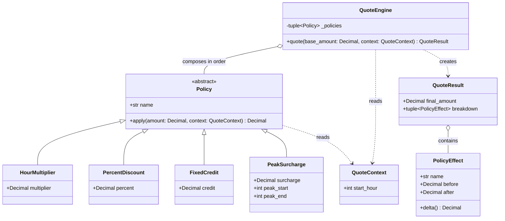

# Task 2 — Venue reservation pricing engine

A tiny, dependency-free quote engine for venue reservations. Each pricing rule (hour multiplier,
membership discount, fixed credit, and a self-chosen peak surcharge) is an independent `Policy`
object that the `QuoteEngine` composes in a caller-supplied order; the engine clamps the running
amount at zero and rounds HALF_UP to whole rials exactly once, at the end. The result carries both
the final amount and an ordered breakdown of every policy's before/after effect.

## Run command

```bash
cd task02_pricing_engine
python3 -m venv .venv && .venv/bin/pip install -r requirements.txt
.venv/bin/python -c "from decimal import Decimal as D; from pricing import QuoteEngine, QuoteContext, HourMultiplier, PercentDiscount, FixedCredit; e = QuoteEngine([HourMultiplier(D('1.5')), PercentDiscount(D('0.10')), FixedCredit(D('200'))]); print(e.quote(D('1000'), QuoteContext(10)))"
```

Real output of that command:

```text
QuoteResult(final_amount=Decimal('1150'), breakdown=(PolicyEffect(name='HourMultiplier', before=Decimal('1000'), after=Decimal('1500.0')), PolicyEffect(name='PercentDiscount', before=Decimal('1500.0'), after=Decimal('1350.000')), PolicyEffect(name='FixedCredit', before=Decimal('1350.000'), after=Decimal('1150.000'))))
```

## Test command

```bash
cd task02_pricing_engine
.venv/bin/ruff format . && .venv/bin/ruff check . && .venv/bin/ruff format --check . && .venv/bin/python -m pytest -q
.venv/bin/python -m pytest -q --cov=pricing --cov-report=term-missing
```

Measured results (Python 3.14.4, pytest 9.2.0):

- Quality gate: `8 files left unchanged`, `All checks passed!`, `8 files already formatted`, `26 passed`.
- Coverage: `94` statements, `0` missed, `100%` (`pricing/__init__.py`, `engine.py`, `model.py`, `money.py`, `policies.py` all 100%).
- The shared contract test is parametrized over all four policies, so it runs four times; the suite totals 26 passing tests.

## Files

- `pricing/money.py` — `to_decimal`: the single no-float gate for money values.
- `pricing/model.py` — `QuoteContext`, `PolicyEffect`, `QuoteResult`, abstract `Policy`.
- `pricing/policies.py` — `HourMultiplier`, `PercentDiscount`, `FixedCredit`, `PeakSurcharge`.
- `pricing/engine.py` — `QuoteEngine.quote`: applies the composition, clamps, rounds once.
- `tests/test_spec_engine.py` — spec samples/acceptance and engine behavior.
- `tests/test_spec_policies.py` — per-policy tests and the shared contract test.
- `tests/test_spec_constraints.py` — no-float, extensibility and immutability constraints.

## Assumptions

- Money inputs are `Decimal` or exact `int`; `float`, `bool` and strings are rejected with `TypeError` in both the engine and the policy constructors.
- `PercentDiscount(percent)` takes a fraction in `[0, 1]` (`Decimal("0.10")` means 10%).
- `start_hour` is an `int` in `0..23`; out-of-range hours raise `ValueError`.
- The running amount is clamped to zero after each policy, so no breakdown `after` value is negative; the clamp happens before the single final `quantize(Decimal("1"), ROUND_HALF_UP)`.
- Breakdown values keep their intermediate `Decimal` precision (no per-step rounding) so each step's effect is transparent; only `final_amount` is rounded to whole rials.
- Policy order is exactly the order of the iterable passed to `QuoteEngine`; the spec's order is multiplier → discount → credit, with the optional 4th policy appended by the caller.
- `QuoteContext`, `QuoteResult`, `PolicyEffect` and every concrete policy are frozen dataclasses: a quote is pure and re-running it on the same input yields an equal result.

## Deliverables

### Code

Measured with `wc -l`: `pricing/engine.py` is 29 lines, `policies.py` 71, `model.py` 50,
`money.py` 16, `__init__.py` 19; the largest test file is `test_spec_constraints.py` at 99 lines.
All amounts are `Decimal`. No `float` appears anywhere in the implementation.

### Class diagram



### Shared contract test

`tests/test_spec_policies.py::test_spec_shared_contract_all_policies` is parametrized over
`HourMultiplier`, `PercentDiscount`, `FixedCredit` and `PeakSurcharge`. For each one it asserts: the
object is a `Policy`; `name` is a non-empty string; `apply()` returns a `Decimal`; the result is
deterministic; neither the context nor the input amount is mutated; and a zero amount is handled.
The measured run shows this test passing for all four policies.

### The four OOP concepts

- **Polymorphism** — `QuoteEngine.quote` calls `policy.apply(amount, context)` without knowing which concrete rule it holds. A fifth rule defined entirely in a test (`LoyaltyBonus`) is accepted by the unchanged engine, which is exactly what `test_spec_add_policy_without_editing_engine` proves.
- **Encapsulation** — each frozen policy owns its own parameters and the validation of those parameters in `__post_init__`. The engine hides the running amount, the zero clamp and the single rounding step behind `quote()`; `QuoteContext` and `QuoteResult` are immutable, so callers cannot reach in and corrupt a quote mid-flight.
- **Abstraction** — the `Policy` ABC exposes only `name` and `apply(Decimal, QuoteContext) -> Decimal`; callers reason about "a pricing rule", not about how multiplication or percentages are computed. `to_decimal` similarly abstracts the "no float" rule into one function used everywhere.
- **Composition** — `QuoteEngine` holds an ordered tuple of independent policy *objects* and composes their effects at runtime rather than inheriting a fixed formula. Ordering is a caller decision; adding or reordering a policy needs no change to the engine class.

### Self-chosen 4th policy: `PeakSurcharge`

Definition: `PeakSurcharge(surcharge: Decimal, peak_start: int, peak_end: int)`. When the
reservation's `start_hour` falls inside the **inclusive** window `[peak_start, peak_end]`, the rule
adds the fixed `surcharge` to the running amount; outside the window it returns the amount
unchanged. This models a peak-hour premium and, like the other policies, works on exact `Decimal`
values only and is clamped/rounded by the engine.

Measured integration: with base 1000, multiplier 1.5, discount 10%, credit 200 and
`PeakSurcharge(500, 18, 21)`, a 10:00 quote is `1150` and a 19:00 quote is `1650`; the 19:00
breakdown ends with `PolicyEffect(name='PeakSurcharge', ...)`.

### Spec acceptance numbers (measured)

| Input | Result |
| --- | --- |
| base 1000, multiplier 1.5, discount 10%, credit 200 | `1150` |
| same, credit 2000 | `0` |
| same input quoted twice | equal `QuoteResult` objects |
| 1000 × 1.0049 then −10% | `904` (proves rounding only at the end) |
| 1000 × 1.0005 | `1001` (ROUND_HALF_UP) |
| base 1000 + PeakSurcharge(500, 18, 21) at hour 19 | `1650` |

## Mutation spot-check

Each mutation was applied to the real source, the suite was run, and the file was restored from a
backup before the next one. Real tails:

1. **Flipped the discount comparison** — replaced `Decimal("1") - self.percent` with `Decimal("1") + self.percent` in `PercentDiscount.apply`: **5 failed, 21 passed** (including `test_spec_percent_discount_reduces_by_percentage`).
2. **Dropped the zero clamp** — replaced `max(_ZERO, policy.apply(...))` with `policy.apply(...)` in `QuoteEngine.quote`: **2 failed, 24 passed** (including `test_spec_acceptance_credit_larger_than_amount_clamps_to_zero`).
3. **Changed the rounding mode** — `ROUND_HALF_UP` → `ROUND_HALF_EVEN` in `QuoteEngine.quote`: **12 failed, 14 passed** (including `test_spec_empty_policy_list_returns_rounded_base`).
4. **Rounded at every step** — appended `.quantize(_RIAL, rounding=ROUND_HALF_UP)` to each policy result: **1 failed, 25 passed** (`test_spec_behavior_rounding_half_up_only_at_the_end`).

After restoring, the final run was `26 passed`.

## Unfinished parts

None known.
