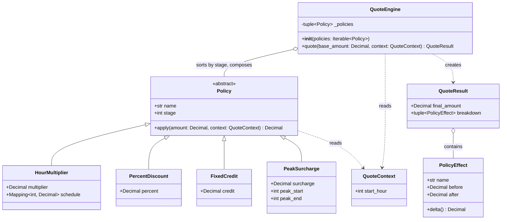

# Task 2 — Venue reservation pricing engine

A small, dependency-free quote engine for venue reservations. Each pricing rule (hour multiplier,
membership discount, fixed credit, and a self-chosen peak surcharge) is an independent `Policy`
object; the `QuoteEngine` sorts them by their declared `stage` and always applies the spec order
(multiplier → discount → surcharge → fixed credit), whatever order the caller supplied. The engine
clamps at zero and rounds HALF_UP to whole rials exactly once, at the end, and the result carries
both the final amount and an ordered breakdown of every policy's before/after effect.

## Run command

```bash
cd task02_pricing_engine
python3 -m venv .venv && .venv/bin/pip install -r requirements.txt
.venv/bin/python -c "from decimal import Decimal as D; from pricing import QuoteEngine, QuoteContext, HourMultiplier, PercentDiscount, FixedCredit; e = QuoteEngine([HourMultiplier(D('1.5')), PercentDiscount(D('0.10')), FixedCredit(D('200'))]); print(e.quote(D('1000'), QuoteContext(10)))"
```

Real output of that command:

```text
QuoteResult(final_amount=Decimal('1150'), breakdown=(PolicyEffect(name='HourMultiplier', before=Decimal('1000'), after=Decimal('1500.0')), PolicyEffect(name='PercentDiscount', before=Decimal('1500.0'), after=Decimal('1350.000')), PolicyEffect(name='FixedCredit', before=Decimal('1350.000'), after=Decimal('1150.000'))))
```

## Test command

```bash
cd task02_pricing_engine
.venv/bin/ruff format . && .venv/bin/ruff check . && .venv/bin/ruff format --check . && .venv/bin/python -m pytest -q
.venv/bin/python -m pytest -q --cov=pricing --cov-report=term-missing
```

Measured results (Python 3.12.16, pytest 8.4.2, ruff 0.17.6):

- Quality gate: `10 files left unchanged`, `All checks passed!`, `10 files already formatted`, `39 passed`.
- Coverage: `145` statements, `0` missed, `100%` (`pricing/__init__.py`, `engine.py`, `model.py`, `money.py`, `policies.py` all 100%).
- The shared contract test is parametrized over all four policies, so it runs four times; the suite totals 39 passing tests.

## Files

- `pricing/money.py` — `to_decimal`: the single no-float gate for money values.
- `pricing/model.py` — stage constants, `QuoteContext`, `PolicyEffect`, `QuoteResult`, abstract `Policy`.
- `pricing/policies.py` — `HourMultiplier`, `PercentDiscount`, `FixedCredit`, `PeakSurcharge`.
- `pricing/engine.py` — `QuoteEngine.quote`: stage-sorts the composition, clamps, rounds once.
- `tests/test_spec_engine.py` — spec samples/acceptance and engine behavior.
- `tests/test_spec_policies.py` — per-policy tests and the shared contract test.
- `tests/test_spec_constraints.py` — no-float, extensibility and immutability constraints.
- `tests/test_spec_reviewer_fixes.py` — stage order, start-hour schedule and positive-multiplier regressions.

Measured with `wc -l`: `pricing/engine.py` is 37 lines, `policies.py` 112, `model.py` 59,
`money.py` 16, `__init__.py` 34; the largest test file is `test_spec_reviewer_fixes.py` at 179 lines.
All amounts are `Decimal`. No `float` appears anywhere in the implementation.

## Stage contract (adding a policy from outside)

A `Policy` subclass declares an integer class attribute `stage`; lower numbers apply first.
`QuoteEngine` sorts with Python's stable `sorted()`, so policies sharing a stage keep the caller's
relative order. Built-in stages are public constants in `pricing.model` (also re-exported from
`pricing`): `STAGE_MULTIPLIER=10`, `STAGE_DISCOUNT=20`, `STAGE_SURCHARGE=30`, `STAGE_CREDIT=40`.
A custom policy that declares no stage inherits `STAGE_EXTERNAL=100` and runs last. No engine edit
is needed: subclass `Policy`, set `name`, optionally set `stage`, and implement
`apply(amount: Decimal, context: QuoteContext) -> Decimal`. A non-integer `stage` raises
`TypeError` at engine construction. This is what keeps the spec order (credit last) stable even
when the caller passes the policies in reverse.

## Assumptions

- Money inputs are `Decimal` or exact `int`; `float`, `bool` and strings are rejected with `TypeError` in both the engine and the policy constructors.
- `PercentDiscount(percent)` takes a fraction in `[0, 1]` (`Decimal("0.10")` means 10%).
- `start_hour` is an `int` in `0..23`; out-of-range hours raise `ValueError`.
- `HourMultiplier` takes an optional fixed `multiplier` and/or an optional hour→multiplier `schedule`. A schedule entry for `context.start_hour` wins; otherwise the fixed multiplier is used as fallback. Every multiplier must be positive (`ValueError` for zero or negative). With no source at all, construction fails; with a schedule only and a missing hour, `apply()` fails with a clear `ValueError`.
- The schedule is copied into an immutable `MappingProxyType`, so a frozen policy cannot be mutated through it. Schedule keys must be int hours in `0..23`.
- The running amount is clamped to zero after each policy, so no breakdown `after` value is negative; the clamp happens before the single final `quantize(Decimal("1"), ROUND_HALF_UP)`.
- Breakdown values keep their intermediate `Decimal` precision (no per-step rounding) so each step's effect is transparent; only `final_amount` is rounded to whole rials.
- Policy order is determined by `stage`, not by caller order; the spec's order is multiplier → discount → credit, with optional extra policies assigned their own stages. `PeakSurcharge` uses stage 30 so the fixed credit remains last, as the spec requires.
- **Test changed after the reviewer finding:** `test_spec_fourth_policy_peak_surcharge_composes_in_engine` previously asserted that the peak surcharge was the *last* breakdown item because it was appended last by the caller. That contradicted the spec's "fixed credit at the end", so it now asserts the full spec order. Its amount assertions (`1150` / `1650`) were kept unchanged.
- `QuoteContext`, `QuoteResult`, `PolicyEffect` and every concrete policy are frozen dataclasses: a quote is pure and re-running it on the same input yields an equal result.

## Deliverables

### Class diagram



### Shared contract test

`tests/test_spec_policies.py::test_spec_shared_contract_all_policies` is parametrized over
`HourMultiplier`, `PercentDiscount`, `FixedCredit` and `PeakSurcharge`. For each one it asserts: the
object is a `Policy`; `name` is a non-empty string; `apply()` returns a `Decimal`; the result is
deterministic; neither the context nor the input amount is mutated; and a zero amount is handled.
The measured run shows this test passing for all four policies.

### The four OOP concepts

- **Polymorphism** — `QuoteEngine.quote` calls `policy.apply(amount, context)` without knowing which concrete rule it holds. A fifth rule defined entirely in a test (`LoyaltyBonus`, or `Tax` with `stage = 25`) is accepted by the unchanged engine; `test_spec_add_policy_without_editing_engine` and `test_spec_external_policy_declares_stage_without_editing_the_engine` prove it.
- **Encapsulation** — each frozen policy owns its parameters and validates them in `__post_init__` (including positive multipliers and valid schedule hours); the schedule is copied into an immutable mapping. The engine hides the running amount, the stage sort, the zero clamp and the single rounding step behind `quote()`; `QuoteContext` and `QuoteResult` are immutable, so callers cannot corrupt a quote mid-flight.
- **Abstraction** — the `Policy` ABC exposes only `name`, `stage` and `apply(Decimal, QuoteContext) -> Decimal`; callers reason about "a pricing rule and its stage", not about multiplication or percentages. `to_decimal` abstracts the "no float" rule into one function, and the exported stage constants abstract the numeric ordering into named stages.
- **Composition** — `QuoteEngine` holds a tuple of independent policy *objects* and composes their effects at runtime rather than inheriting a fixed formula. Ordering is a declared property of each policy (stable sorting resolves ties), so adding, staging or reordering a policy needs no change to the engine class.

### Self-chosen 4th policy: `PeakSurcharge`

Definition: `PeakSurcharge(surcharge: Decimal, peak_start: int, peak_end: int)`, stage 30. When the
reservation's `start_hour` falls inside the **inclusive** window `[peak_start, peak_end]`, the rule
adds the fixed `surcharge` to the running amount; outside the window it returns the amount
unchanged. It sits before the fixed credit so "credit at the end" holds. Like the other policies it
works on exact `Decimal` values only and is clamped/rounded by the engine.

Measured integration with reversed caller input `[PeakSurcharge, FixedCredit, PercentDiscount,
HourMultiplier]`: a 19:00 quote is `1650` and the breakdown order is `HourMultiplier`,
`PercentDiscount`, `PeakSurcharge`, `FixedCredit`.

### Spec acceptance numbers (measured)

| Input | Result |
| --- | --- |
| base 1000, multiplier 1.5, discount 10%, credit 200 | `1150` |
| same, credit 2000 | `0` |
| same input quoted twice | equal `QuoteResult` objects |
| same three policies passed in reverse order | `1150`, breakdown in spec order |
| 1000 × 1.0049 then −10% | `904` (proves rounding only at the end) |
| 1000 × 1.0005 | `1001` (ROUND_HALF_UP) |
| schedule `{9: 1.2, 18: 1.8}` at hours 9 / 18 | `1200` / `1800` (different hours, different results) |
| multiplier `0` or `-1`, fixed or in schedule | `ValueError: ... must be positive` |
| base 1000 + PeakSurcharge(500, 18, 21) at hour 19 | `1650`, credit last in the breakdown |

## Mutation spot-check

Each mutation was applied to the real source on Python 3.12.16, the full 39-test suite was run, and
the file was restored from a backup before the next one. Real tails:

1. **Disabled stage sorting** — replaced `tuple(sorted(policies, key=_policy_stage))` with `tuple(policies)` in `QuoteEngine.__init__`: **6 failed, 33 passed** (including `test_spec_engine_enforces_spec_order_for_reversed_input`).
2. **Accepted a zero multiplier** — changed `multiplier <= Decimal("0")` to `multiplier < Decimal("0")` in `_positive_multiplier`: **1 failed, 38 passed** (`test_spec_hour_multiplier_rejects_non_positive_multipliers`, "DID NOT RAISE").
3. **Ignored the hour schedule** — replaced `self.schedule.get(context.start_hour, self.multiplier)` with `self.multiplier` in `HourMultiplier.apply`: **2 failed, 37 passed** (`test_spec_hour_multiplier_schedule_uses_start_hour` and `test_spec_hour_multiplier_schedule_overrides_explicit_fallback`).

After restoring, the final run was `39 passed` with `100%` coverage.

## Unfinished parts

None known.
