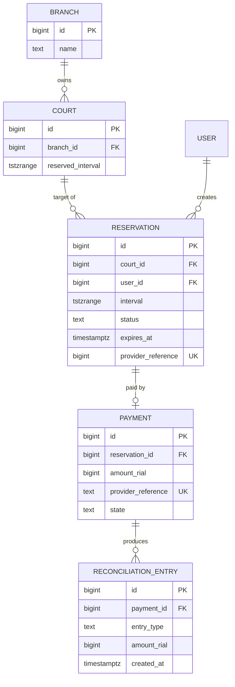
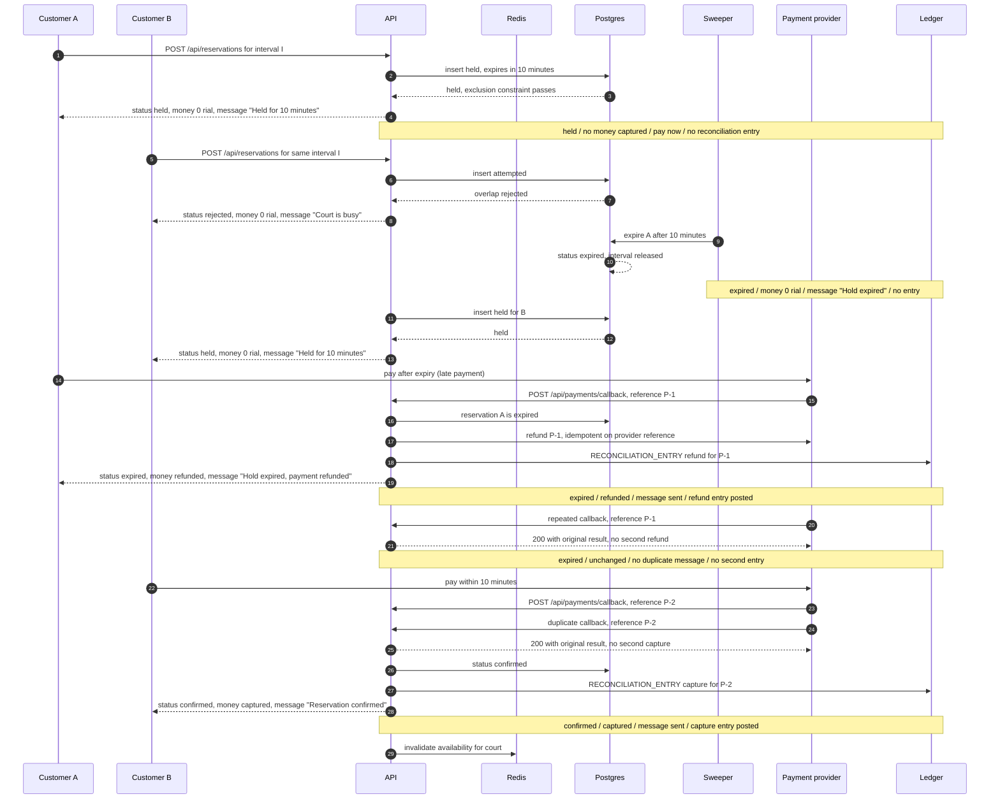

# Task 10 — Multi-branch ERP backend architecture

## Overview

This is the backend architecture for 80 branches offering court reservation, online payment and financial reporting; implementation is not required. It defines the API boundary, data model, the late-payment request flow, a capacity model, the 250 ms availability SLO, indicators and alerts, a recovery plan and a load-test plan. Every number below is a design input from the specification or a proposed target — none is a measurement, because this task produces documentation only.

## Assumptions

- 80 branches, each owning several courts; a court has at most one active interval at a time.
- Peak load is 300 reservation requests per second and 3000 capacity-view requests per second, aggregated across all branches.
- One hot court receives half of the reservation requests, so about 150 requests per second target a single court.
- A temporary reservation is held for 10 minutes (`held` state); a sweeper expires holds that pass their deadline.
- Payment providers may call back late, more than once, or out of order; clients may retry.
- A branch manager sees only their own branch data; the central finance manager sees the aggregate report. The report may be delayed up to 5 minutes.
- Money is stored as integer rial, never a float. All timestamps are timezone-aware UTC.
- Capacity and latency figures are spec inputs or targets, not measured results; no benchmark was run in this documentation-only task.

## API boundary

| Endpoint | Auth / scope | Contract |
| --- | --- | --- |
| `POST /api/reservations` | JWT carrying `branch_id` | Body: `court_id`, `interval_start`, `interval_end`. Creates a `held` reservation with a 10-minute expiry; the database exclusion constraint is the final overlap guard. Returns `held`, `rejected` (overlap) or `rejected` (hold still active). |
| `POST /api/payments/callback` | Provider signature | Body: `provider_reference`, `reservation_id`, `amount_rial`, `event`. Idempotent on unique `provider_reference`: a repeated callback returns the original result and performs no second capture or refund. |
| `GET /api/courts/{court_id}/availability` | JWT, any authenticated user | Reads the Redis availability cache (short TTL) and returns free intervals. This is the capacity-viewing hot path with a p95 target of 250 ms. |
| `GET /api/reports/finance` | JWT role `branch_manager` or `central_finance` | Branch managers are filtered to their own branch; central finance receives the aggregate report. Served from a read replica of materialized aggregates with up to 5-minute staleness. |

Rejections and refunds are business outcomes with HTTP 200/409, not transport failures, so provider retries stay idempotent.

## ERD



Overlap rule: a PostgreSQL exclusion constraint `EXCLUDE USING gist (court_id WITH =, interval WITH &&)` on the immutable `tstzrange` interval forbids two active intervals for the same court. `held` reservations participate, so a hold blocks a second customer until the sweeper expires it. `amount_rial` is an integer count of rial.

## Sequence diagram

The diagram shows two customers choosing the same interval, a late payment from Customer A after expiry and hand-over to Customer B, and repeated callbacks. Each note records the reservation status, the money, the user message and the reconciliation path.



## Late-payment walkthrough

Customer A and Customer B request the same interval. A wins the hold; A pays only after the 10-minute expiry and after the interval has been handed over to B, so this is a late payment.

| Step | Reservation status | Money | User message | Financial reconciliation path |
| --- | --- | --- | --- | --- |
| 1. A holds the interval | `held`, expires in 10 minutes | 0 rial, no money captured | "Held for 10 minutes, please pay" | No callback yet, no reconciliation entry |
| 2. B requests the same interval | B has no reservation; A stays `held` | 0 rial | "Court is busy, try another interval" | No entry |
| 3. Sweeper expires A | A becomes `expired`, interval released | 0 rial | "Your hold expired" | No entry; expiry is not a money event |
| 4. B takes the interval | B becomes `held` | 0 rial | "Held for 10 minutes, please pay" | No entry |
| 5. A's late payment callback arrives (reference P-1) | A stays `expired`; B stays `held` | Full amount automatically refunded in integer rial; no money retained | "Your hold expired; we refunded your payment" | Callback validated, `PAYMENT` marked `refunded`, `RECONCILIATION_ENTRY` of type `refund` posted and linked to P-1 |
| 6. Repeated callback for P-1 | A stays `expired` | No second refund, unchanged | No duplicate message | Idempotent callback returns the original result because `provider_reference` is unique; no second entry |
| 7. B pays within 10 minutes | B becomes `confirmed` | Amount captured, no money refunded | "Reservation confirmed" | `RECONCILIATION_ENTRY` of type `capture` posted; included in the central finance aggregate report (up to 5-minute staleness) |

## Capacity model

| Input | Value | Handling |
| --- | --- | --- |
| Branches | 80 | Each branch scopes its own reads by `branch_id`; indexes lead with `branch_id`. |
| Reservation writes | 300 requests/s | Single writer per reservation; PostgreSQL connection pool sized for 300 writes/s, batched sweeper deletes/expires in chunks. |
| Capacity views | 3000 requests/s | Redis availability cache with a short TTL (2 seconds) and invalidate-on-change on every reservation state change; one cached GET per view. |
| Hot court | about 150 reservation requests/s | Per-court serialization with a PostgreSQL advisory lock keyed by `court_id`; the exclusion constraint remains the correctness guard, and serialization avoids conflict storms on `tstzrange`. |
| Report freshness | up to 5 minutes | Read replica of materialized aggregates refreshed on a 5-minute schedule. |

The hot court is the bottleneck candidate: 150 of the 300 reservation requests/s target one court, so those writes are serialized per court while the other 150 requests/s and all 3000 capacity views remain parallel. A stale Redis view can show a free slot that the database then rejects, which is acceptable because the exclusion constraint never lets two active intervals coexist. These are design inputs and targets, not measured throughput.

## SLO

- Capacity viewing (availability reads): p95 end-to-end latency at the API gateway is at most **250 ms** when the system serves 3000 requests/s, measured in 1-minute windows.
- No other SLO is claimed in this design; additional objectives need real load-test data.

## Indicators and alerts

| Indicator | Definition | Proposed alert |
| --- | --- | --- |
| p95 availability latency | p95 of `GET /api/courts/{court_id}/availability` | p95 above 250 ms for 5 minutes |
| 5xx error rate | Failed requests divided by all requests | Above 1% for 5 minutes |
| Redis cache hit rate | Cache hits divided by capacity-view reads | Below 95% for 5 minutes |
| Callback lag | Age of the oldest unprocessed payment callback | Above 30 seconds |
| Sweep lag | Age of the oldest `held` reservation past its 10-minute expiry | Above 60 seconds |
| Hot-court lock wait | p95 advisory-lock wait time for the hot court | Above 100 ms for 5 minutes |
| Reconciliation mismatches | Captured or refunded payments without a matching reconciliation entry | Any nonzero count |

Thresholds are proposals to be validated by the load test, not measured values.

## Recovery plan

- **Repeated or late callbacks:** the unique `provider_reference` makes callback handling idempotent; a replay returns the original result and never double-captures or double-refunds. A late payment after expiry is refunded and a `RECONCILIATION_ENTRY` is posted, with the user informed.
- **Failed callback processing:** retry with exponential backoff through an outbox; after repeated failures move the event to a dead-letter queue and replay it manually once the provider is reachable.
- **Money mismatch:** compare captured and refunded payments with the provider settlement file, create an adjusting `RECONCILIATION_ENTRY`, and keep the original entry for audit. No money movement is deleted.
- **Sweeper lag:** backfill expired holds in batches; overlapping writes are still blocked by the exclusion constraint.
- **Redis loss:** rebuild the availability cache from PostgreSQL; a stale cache only affects what a user sees, never what the database accepts.
- **Replica lag above 5 minutes:** keep serving the last good materialized snapshot with an explicit staleness notice, and do not promote the replica for reports until it catches up.

## Load test plan

- **Tool:** k6, driven from the same region as the API gateway.
- **Ramp:** 0 to 300 reservation requests/s and 0 to 3000 capacity-view requests/s over 10 minutes, hold for 30 minutes, ramp down over 5 minutes.
- **Hot-court scenario:** 150 reservation requests/s aimed at one court, the other 150 spread over the remaining courts, with capacity views distributed across all 80 branches.
- **Mixed scenario:** normal holds, expiries, duplicate provider callbacks and late payments injected at a fixed rate.
- **Measurements to record:** p50/p95/p99 capacity-view latency, reservation error rate, database lock waits, Redis hit rate, sweep lag and reconciliation mismatches.
- **Pass criteria:** p95 capacity viewing stays at or below 250 ms during the 30-minute hold, zero overlapping active intervals, zero duplicate captures or refunds from repeated callbacks, and no hold older than its 10-minute expiry beyond the alert tolerance.
- These criteria are targets for a future run; no load test has been executed in this documentation-only task.

## Decisions and limitations

**Decision 1 — Redis availability cache with a 2-second TTL and invalidate-on-change instead of querying PostgreSQL for every capacity view.**
Cost: an additional Redis dependency and cache-invalidation code. Limitation: a view can be up to 2 seconds stale, so a customer may see a free slot and then receive a "busy" message; correctness is preserved by the exclusion constraint, but that user experience cost is accepted to meet the 250 ms p95 target.

**Decision 2 — Financial reports from a read replica of materialized aggregates refreshed every 5 minutes instead of live queries on the primary.**
Cost: a replica plus refresh jobs and replica-lag monitoring. Limitation: reports lag by up to 5 minutes and central finance aggregates are eventually consistent, so they are not suitable for real-time settlement; write traffic on the primary is not slowed by reporting queries.

## Run and test commands

From this folder, with the local virtual environment:

```bash
python3 -m venv .venv
.venv/bin/pip install -r requirements.txt
.venv/bin/python check_doc.py
.venv/bin/python -m pytest -q
.venv/bin/ruff format . && .venv/bin/ruff check . && .venv/bin/ruff format --check .
```

To validate a different document, run `.venv/bin/python check_doc.py path/to/other.md`.

## Unfinished parts

No service code, database schema migration or load-test harness was built, because implementation is not required; all throughput and latency numbers are specification inputs or targets rather than measurements. Alert thresholds and the cache TTL are proposals that must be tuned with a real load test. No deployment, CI or frontend work is included.

## Spot-check record

The checker itself was spot-checked by temporarily damaging a copy of this document, running `check_doc.py`, and restoring it:

- Mutation 1 — removed the `## SLO` heading: checker exited 1 with `FAIL: missing section: ## SLO`.
- Mutation 2 — removed the Mermaid `sequenceDiagram` block: checker exited 1 with `FAIL: missing Mermaid sequenceDiagram` and `FAIL: missing required content: provider reference`.
- Mutation 3 — changed `250 ms` to `500 ms`: checker exited 1 with `FAIL: missing required content: 250 ms`, and `test_spec_p95_capacity_viewing_250_ms` failed under pytest.

Each damage was reverted (the restore was verified byte-for-byte) and the final document passes the checker and the full test suite.
