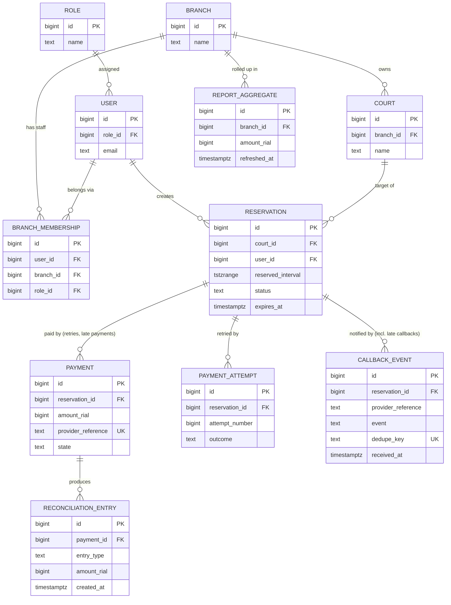

# Task 10 — Multi-branch ERP backend architecture

## Overview

This document designs the backend for 80 branches with court reservation, online payment and
financial reporting; implementation is not required. It specifies the API boundary, ERD, the
late-payment sequence, a capacity model with explicit sizing arithmetic, four SLOs, indicators,
recovery, and a load-test plan. Every performance number below is either a design input from the
specification or a proposed target — none is a measurement, because this task produces
documentation only. The checker and tests here are **structure checks only**: they inspect this
document and the rules that validate it; they do not run a service, a database or a load test.

## Assumptions

- 80 branches, each owning several courts; two active intervals of one court never overlap.
- Peak load is 300 reservation requests/s and 3000 capacity-view requests/s, aggregated across all
  branches; one hot court takes about half of the reservation traffic (about 150 requests/s).
- A temporary reservation is `held` for 10 minutes. Expiry is performed **inline** by the next write
  on that court; a periodic sweeper is cleanup only.
- ⚠ Interpretation: "confirmed" means **the provider captured the money**. A `held` or `expired`
  reservation has captured nothing; a callback that never captured money moves no funds.
- Money is integer rial (never a float); all timestamps are timezone-aware UTC.
- Payment providers may call back late, repeatedly or out of order; clients may retry. A callback
  is trusted only after a signature check and an amount-vs-reservation check.
- A branch manager sees only their own branch data (through a branch membership); the central
  finance manager sees the aggregate report, which may be up to 5 minutes stale.
- Latency figures are design inputs (view p95 250 ms is a spec target), not measured results.
- The checker and the test suite validate the document's technical claims, not a running system.

## API boundary

| Endpoint | Auth / scope | Contract |
| --- | --- | --- |
| `POST /api/reservations` | JWT carrying `branch_id`, role from `USER`/`BRANCH_MEMBERSHIP` | Body: `court_id`, `interval_start`, `interval_end`. Redis `SET NX` gate per `(court, interval)` with a 10 minute TTL; inline expiry, then the insert. Returns `held`, a fast-fail conflict, or a database conflict. |
| `POST /api/payments/callback` | Provider signature check | Body: unique text `provider_reference`, `reservation_id`, `amount_rial`, `event`. Verify signature, then an amount-vs-reservation check, then dedupe on the `CALLBACK_EVENT` key `(provider, provider_reference, event)`. Idempotent: a repeated callback returns the original result with no second capture or refund. |
| `GET /api/courts/{court_id}/availability` | Any authenticated user | Redis availability cache: 2 s TTL for normal courts with invalidate-on-change; a 1-2 s TTL with single-flight, stale-while-revalidate refresh for hot courts. This is the 3000 rps capacity hot path with a 250 ms p95 target. |
| `GET /api/reports/finance` | `branch_manager` or `central_finance` | Managers are filtered to their own branch via `BRANCH_MEMBERSHIP`; central finance reads the `REPORT_AGGREGATE` rollup. Served from materialized aggregates with a bounded staleness budget (below). |

Rejections and refunds are business outcomes (HTTP 200/409), not transport failures, so provider
retries stay idempotent. An availability response is advisory: it may be stale, while the database
constraint remains authoritative.

### Insert path (inline expiry)

There is **no advisory lock** held across the reservation transaction. Per-court serialization is
only the short Redis `SET NX` gate; the database relies on the exclusion constraint. In the same
transaction, **inline expiry** runs before the insert:

```sql
UPDATE reservation SET status = 'expired'
 WHERE court_id = ? AND status = 'held'
   AND expires_at <= now() AND reserved_interval && ?;

INSERT INTO reservation (court_id, reserved_interval, status, expires_at)
VALUES (?, ?, 'held', now() + interval '10 minutes')
ON CONFLICT DO NOTHING;
```

The `UPDATE` frees a hold whose deadline has passed, so the next customer can hold the interval in
that same transaction. The sweeper is cleanup only: it repairs rows no request has touched, but no
request ever waits for it. `ON CONFLICT DO NOTHING` without a conflict target was verified against
the PostgreSQL 16 `INSERT` documentation: with no target it handles conflicts with **all usable
constraints**, including a `NOT DEFERRABLE` exclusion constraint (unlike `DO UPDATE`, which does
not accept exclusion constraints as arbiters), so an overlap inserts zero rows without an
exception. If the constraint is ever made deferrable, catch SQLSTATE 23P01 (`exclusion_violation`)
in the application and return 409. Source: <https://www.postgresql.org/docs/16/sql-insert.html>.

## ERD



`USER`, `ROLE` and `BRANCH_MEMBERSHIP` are the auth tables the API relies on for branch scoping;
`REPORT_AGGREGATE` is the table the finance endpoint reads. `CALLBACK_EVENT.dedupe_key` is unique,
so a replayed provider event cannot be processed twice.

`reserved_interval` is an attribute of RESERVATION (the thing being reserved), not of COURT.
There is no `provider_reference` on RESERVATION: the unique **text** `provider_reference` lives on
PAYMENT, where this unique provider reference makes callbacks idempotent. A reservation has many payments, many
attempts (retries) and many callbacks (including late payments), so all three relationships are
1:N; a 1:0..1 link would make retries and late callbacks impossible to represent.

Overlap guard, enabled with the `btree_gist` extension (needed for the `=` operator in a GiST
index):

```sql
CREATE EXTENSION IF NOT EXISTS btree_gist;

ALTER TABLE reservation ADD CONSTRAINT reservation_no_overlap
    EXCLUDE USING gist (court_id WITH =, reserved_interval WITH &&)
    WHERE status IN ('held','confirmed');
```

The constraint is **partial**: only `held` and `confirmed` rows participate. Without the WHERE clause, expired holds (and refunded/cancelled rows) would keep occupying their intervals forever, so step 4 of the sample ("B takes the interval") would be impossible: the database would reject B until someone deleted A's row. With the partial predicate, inline expiry changes A's `status` to `expired` inside B's transaction, the interval becomes free, and B can hold it. `amount_rial` is an integer count of rial.

## Sequence diagram

The diagram shows two customers choosing the same interval, a late payment from Customer A after
expiry and hand-over to Customer B, and repeated callbacks. B does not "take the interval" by
waiting: B sends a **new** request, and that request performs the inline expiry. Each note records
reservation status, money, user message and the reconciliation path at that step.

```mermaid
sequenceDiagram
    autonumber
    participant CA as Customer A
    participant CB as Customer B
    participant API
    participant RD as Redis
    participant PG as Postgres
    participant SW as Sweeper
    participant PP as Payment provider
    participant LED as Ledger
    CA->>API: POST /api/reservations for interval I
    API->>RD: SET NX gate (court, I), 10 minute TTL
    RD-->>API: gate acquired (winner)
    API->>PG: inline expiry, then INSERT ... ON CONFLICT DO NOTHING
    PG-->>API: held, partial exclusion constraint passes
    API-->>CA: status held, money 0 rial, message "Held for 10 minutes"
    Note over API,LED: status held / money 0 rial, nothing captured / user message "Held for 10 minutes, pay now" / reconciliation no entry
    CB->>API: POST /api/reservations for same interval I
    API->>RD: SET NX gate (court, I) fails, fast-fail 1-2 ms
    API-->>CB: status rejected, money 0 rial, message "Court is busy"
    Note over API,LED: status rejected for B and held for A / money 0 rial / user message "Court is busy" / reconciliation no entry
    Note over SW,PG: A's expires_at passes; sweeper has not run yet
    SW->>PG: cleanup only, removes rows already expired inline
    Note over SW,LED: status expired for A, interval released / money 0 rial / user message "Hold expired" / reconciliation no entry
    CB->>API: NEW POST /api/reservations for interval I (after A's deadline)
    API->>PG: inline expiry: UPDATE reservation SET status = 'expired' WHERE court_id = ? AND status = 'held' AND expires_at <= now() AND reserved_interval && ?
    PG-->>API: A expired in this transaction, interval free
    API->>RD: SET NX gate (court, I) acquired by B
    API->>PG: INSERT held for B, exclusion constraint passes
    PG-->>API: B held
    API-->>CB: status held, money 0 rial, message "Held for 10 minutes"
    Note over API,LED: status held for B (B takes the interval after inline expiry), A expired / money 0 rial / user message "Held for 10 minutes, pay now" / reconciliation no entry
    CA->>PP: pay after expiry (late payment)
    PP->>API: POST /api/payments/callback, reference P-1, signature check and amount-vs-reservation check
    API->>PG: read reservation A: expired, interval now held by B
    API->>PP: refund P-1, idempotent on provider_reference
    API->>LED: RECONCILIATION_ENTRY refund for P-1
    API-->>CA: status expired, money refunded, message "Hold expired, payment refunded"
    Note over API,LED: status expired for A / money refunded in full rial / user message "Hold expired, payment refunded" / reconciliation refund entry posted
    PP->>API: repeated callback, reference P-1, CALLBACK_EVENT dedupe key
    API-->>PP: 200 with original result, no second refund
    Note over API,LED: status expired unchanged / money unchanged, no second refund / user message not repeated / reconciliation no second entry
    Note over API,LED: late payment while interval still free: refund (default) or re-confirm / money refunded or captured / user message explains policy / reconciliation entry per policy
    CB->>PP: pay within 10 minutes
    PP->>API: POST /api/payments/callback, reference P-2
    PP->>API: duplicate callback, reference P-2
    API-->>PP: 200 with original result, no second capture
    API->>PG: status confirmed for B
    API->>LED: RECONCILIATION_ENTRY capture for P-2
    API-->>CB: status confirmed, money captured, message "Reservation confirmed"
    API->>RD: non-hot court invalidate-on-change; hot court single-flight refresh on TTL
    Note over API,LED: status confirmed for B / money captured in rial / user message "Reservation confirmed" / reconciliation capture entry posted
```

## Late-payment walkthrough

Customer A and Customer B request the same interval. A wins the gate and the hold; A pays only after
the 10-minute expiry and after the interval has been handed to B, so this is a late payment.
⚠ Interpretation: "confirmed" means the provider captured the money; the policy choice below is
about whether A's already-captured money is kept or returned.

| Step | Reservation status | Money | User message | Financial reconciliation path |
| --- | --- | --- | --- | --- |
| 1. A holds the interval | A `held`, expires in 10 minutes | 0 rial, no money captured | "Held for 10 minutes, please pay" | No callback yet, no reconciliation entry |
| 2. B requests the same interval | A stays `held`; B fast-fails at the gate | 0 rial | "Court is busy, try another interval" | No entry |
| 3. A's deadline passes | A is still `held` until the next write; no request waits for the sweeper | 0 rial | "Your hold expired" | No entry; expiry is not a money event |
| 4. B sends a NEW request, which runs inline expiry | B becomes `held`, A becomes `expired` in the same transaction | 0 rial | "Held for 10 minutes, please pay" | No entry |
| 5a. A's late callback, interval now taken by B | A stays `expired` | Full amount refunded in integer rial; no money retained | "Your hold expired; we refunded your payment" | signature check, amount-vs-reservation check, `CALLBACK_EVENT` dedupe key, `PAYMENT` marked `refunded`, refund `RECONCILIATION_ENTRY` posted; matched to the provider settlement file |
| 5b. A's late callback, interval still free | A becomes `expired`, then either stays `expired` (refund) or becomes `confirmed` (re-confirm) | Refund in full by default; captured only if re-confirm is chosen | "Hold expired; refunded" or "Hold re-confirmed" | Same checks and dedupe; refund entry by default, or capture entry plus a new hold/confirmation entry when re-confirmed; matched to the provider settlement file |
| 6. Repeated callback for P-1 | A `expired` | No second refund; unchanged | No duplicate message | Idempotent callback returns the original result because the `CALLBACK_EVENT` dedupe key and text `provider_reference` are unique; no second entry |
| 7. B pays within 10 minutes | B becomes `confirmed` | Amount captured, no money refunded | "Reservation confirmed" | `RECONCILIATION_ENTRY` of type `capture` posted; appears in the central finance aggregate within the staleness budget |

Every callback is matched against the provider settlement file during daily reconciliation; an
unmatched capture or refund produces an entry in `RECONCILIATION_ENTRY`, never a silent money change.

## Capacity model

| Input | Value | Handling |
| --- | --- | --- |
| Branches | 80 | Reads scoped by `branch_id`; indexes lead with `branch_id`. |
| Reservation writes | 300 requests/s | Redis gate before the DB; batched expiry cleanup; write pool sized below. |
| Capacity views | 3000 requests/s | Redis cache with a 2 s TTL for normal courts; 1-2 s TTL and single-flight stale-while-revalidate for hot courts. |
| Hot court | about 150 reservation requests/s | A Redis `SET NX` gate per `(court, interval)` with a 10 minute TTL; the partial exclusion constraint is the final guard. Per-court serialization happens at the gate, never in the DB transaction. |
| DB write | 10 ms (design input) | Paid only by winners of the gate; rejected requests cost 1-2 ms. |
| Report freshness | target ≤ 5 minutes | Materialized aggregates; bounded budget below, served via a read replica. |

### Sizing arithmetic (design inputs, not measurements)

Inputs: view p95 250 ms, reservation-commit p95 target 250 ms, 3000 view rps, 300 reservation rps,
hot court 150 rps, 10 ms DB write per winner, 1-2 ms gate/fast-fail (use 2 ms worst case), 6 writer
connections (derived below), 50 in-flight requests per worker, 2× safety factor.

- Little's Law (view path): 3000 × 0.25 = 750 in-flight capacity-view requests at p95. That is what
  the gateway and connection buffers must hold.
- Little's Law (write path): 300 × 0.25 = 75 in-flight reservations, isolated from the 750 view
  requests by separate worker pools and connection pools.
- Service budget per hot-court request: 1 / 150 = 6.67 ms.
- Rejected design (why the old document was wrong): a transaction-level advisory lock is held until
  commit, so its hold time is at least the 10 ms DB write. ρ = 150 × 0.010 = 1.5 > 1 — an unstable
  queue; the wait diverges instead of staying under the 100 ms alert. A 4 ms in-memory section does
  not help, because the lock is not released at the end of that section.
- Adopted design, gate: every request pays the Redis gate; ρ_gate = 150 × 0.002 = 0.3, so the M/M/1
  wait estimate is 0.3 / (1 - 0.3) × 2 = 0.86 ms and the gate adds about 2.9 ms in the worst case.
  Losers are rejected there in 1-2 ms with no DB write.
- Adopted design, DB: only winners pay the 10 ms write. For one hot interval, the 10 minute gate TTL
  admits at most one winner per TTL: 1/600 = 0.0017 writes/s, so 0.0017 × 0.010 = 0.000017 write
  utilization. If instead all 150 rps are winners on distinct intervals, the writes are independent
  and run on the writer pool: ρ_writer = 150 × 0.010 / 6 = 0.25 per connection, still stable. There
  is no single serialized 10 ms queue.
- Writer connections: 300 × 0.01 = 3 at p95; with the 2× safety factor choose 6 writer connections.
- Workers: 750 / 50 = 15 async view workers (for example 5 instances × 3 workers). The write pool
  needs 75 / 50 = 2 workers, rounded up to 3 per pool for headroom.

A stale Redis view can advertise a slot that the database then rejects; this is acceptable because
two active intervals of one court never overlap: the partial exclusion constraint rejects the
second insert. Invalidate-on-change at 150 writes/s would make the hot court effectively
uncacheable, so hot courts use a 1-2 s TTL with single-flight refresh and stale-while-revalidate
(the first reader after expiry rebuilds once; concurrent readers get the stale value immediately).
These are calculations from design inputs, not measured throughput.

### Report staleness budget

A materialized view refreshed on a lagging replica can exceed 5 minutes: the refresh interval and
replica lag add up, so "refresh every 5 minutes" alone does not bound staleness. Budget (design
inputs): refresh interval 2 min + worst-case replica lag 3 min = 5 min. Arithmetic: 2 min + 3 min = 5 min, so staleness ≤ 5 min.
Every snapshot carries a `refreshed_at` timestamp shown with the report. The alternative is to
refresh the materialized view on the primary and publish a timestamped snapshot; that removes
replica lag from the budget and is the fallback when lag exceeds 3 minutes.

## SLO

Proposed targets (to be confirmed by the load test; no measurements exist yet).

| Objective | Proposed target | Window |
| --- | --- | --- |
| Capacity-view availability | p95 end-to-end latency ≤ 250 ms at 3000 requests/s | 1 minute |
| Reservation commit | p95 from `POST /api/reservations` to committed `held` ≤ 250 ms | 1 minute |
| Callback processing | p95 from provider callback to persisted payment state ≤ 2 s | 5 minutes |
| Financial report staleness | report `refreshed_at` ≤ 5 min behind wall clock | continuous |
| Hot-court gate wait | p95 gate wait ≤ 100 ms at 150 requests/s | 5 minutes |

## Indicators and alerts

| Indicator | Definition | Proposed alert |
| --- | --- | --- |
| p95 availability latency | p95 of `GET /api/courts/{court_id}/availability` | Above 250 ms for 5 minutes |
| 5xx error rate | Failed requests divided by all requests | Above 1% for 5 minutes |
| Redis cache hit rate (non-hot courts) | Cache hits divided by capacity-view reads, excluding hot courts; hot courts are judged by stale-age instead | Below 95% for 5 minutes |
| Callback lag | Age of the oldest unprocessed payment callback | Above 30 seconds |
| Sweep lag | Age of the oldest `held` reservation past its 10-minute expiry (cleanup backlog only) | Above 60 seconds |
| Hot-court gate wait | p95 Redis `SET NX` gate wait for the hot court | Above 100 ms for 5 minutes |
| Staleness | `now - refreshed_at` on reports | Above 5 minutes |
| Reconciliation mismatches | Captured/refunded payments without a matching reconciliation entry, including no provider settlement file match | Any nonzero count |

Thresholds are proposals to be validated by the load test, not measured values.

## Recovery plan

- **Repeated or late callbacks:** the unique `CALLBACK_EVENT` dedupe key and unique text
  `provider_reference` make callbacks idempotent; a replay returns the original result, never
  double-captures or double-refunds. A late payment after expiry is refunded by default (or
  re-confirmed when the interval is still free and policy allows), posted to reconciliation, and
  explained to the user.
- **Failed callback processing:** retry with exponential backoff via an outbox; after repeated
  failures move the event to a dead-letter queue and replay it manually once the provider recovers.
- **Money mismatch:** compare captured/refunded payments with the provider settlement file, create
  an adjusting `RECONCILIATION_ENTRY`, and keep the original entry for audit; no money movement is
  deleted.
- **Redis gate loss:** fall back to the exclusion constraint alone — a loser gets a 409 from
  `ON CONFLICT DO NOTHING`; correctness is unchanged, only the fast-fail path is lost.
- **Cache refresh storm:** the single-flight lock ensures only one hot-court rebuild per TTL;
  stale-while-revalidate keeps readers fast while it runs.
- **Sweeper lag:** backfill expired holds in batches; inline expiry has already released intervals
  for active requests, and changing `status` releases the rest because the constraint is partial.
- **Redis loss:** rebuild the availability cache from PostgreSQL; a stale cache only affects what a
  user sees, never what the database accepts.
- **Replica lag above 3 minutes:** refresh on the primary or keep serving the last timestamped
  snapshot with an explicit staleness notice; never promote a lagging replica for reports.

## Load test plan

- **Tool:** k6, driven from the same region as the API gateway.
- **Ramp:** 0 to 300 reservation requests/s and 0 to 3000 capacity-view requests/s over 10 minutes,
  hold for 30 minutes, ramp down over 5 minutes.
- **Hot-court scenario:** 150 reservation requests/s to one court and the same popular interval,
  the other 150 spread over the remaining courts, with capacity views distributed across all 80
  branches; record gate fast-fails and winner DB writes separately.
- **Mixed scenario:** normal holds, expiries, duplicate provider callbacks and late payments at a
  fixed rate; a deliberately held slot is expired inline by a second customer's NEW request.
- **Measurements to record:** p50/p95/p99 capacity-view latency, commit latency, callback lag,
  reservation error rate, hot-court gate waits, Redis hit rate per court class, sweep lag, report
  staleness and reconciliation mismatches.
- **Pass criteria:** p95 capacity viewing ≤ 250 ms during the 30-minute hold, zero overlapping
  active intervals, zero duplicate captures/refunds from repeated callbacks, staleness ≤ 5 min,
  and no hold older than 10 minutes beyond the alert tolerance.
- These criteria are targets for a future run; no load test has been executed in this
  documentation-only task.

## Decisions and limitations

**Decision 1 — Redis availability cache with a 2 s TTL for normal courts and a 1-2 s TTL with
single-flight stale-while-revalidate for hot courts, instead of invalidating on every write.**
Cost: an extra Redis dependency and a single-flight lock. Limitation: a view can be up to 2 seconds
stale, so a customer may see a free slot and then get "busy"; correctness is preserved by the
partial exclusion constraint, but that user-experience cost is accepted to meet the 250 ms p95
target. Invalidate-on-change at 150 writes/s would keep the hot court uncached.

**Decision 2 — Financial reports from materialized aggregates on a read replica with a bounded
refresh/lag budget instead of live queries on the primary.** Cost: a replica, refresh jobs and lag
monitoring. Limitation: reports lag by up to 5 minutes and central finance aggregates are
eventually consistent, so they are unsuitable for real-time settlement; primary write traffic is
not slowed by reporting queries.

**Decision 3 — Redis `SET NX` gate plus the exclusion constraint instead of a transaction-level
advisory lock.** Cost: one extra Redis round trip per reservation and a gate key per (court,
interval). Limitation: a Redis failure removes the fast-fail path (the database still rejects
overlaps), and a stale gate key can delay a legitimate retry until its TTL expires. The gate is
never a correctness mechanism: ρ = 150 × 0.010 = 1.5 for the rejected lock design is replaced by
ρ_gate = 0.3 at the gate.

## Run and test commands

From this folder, with the local virtual environment created with Python 3.12:

```bash
python3 -m venv .venv
.venv/bin/pip install -r requirements.txt
.venv/bin/python check_doc.py
.venv/bin/python -m pytest -q
.venv/bin/ruff format . && .venv/bin/ruff check . && .venv/bin/ruff format --check .
```

To validate a different document, run `.venv/bin/python check_doc.py path/to/other.md`.

## Unfinished parts

No service code, schema migration or load-test harness was built, because implementation is not
required; all throughput, latency and capacity numbers are specification inputs or proposed targets
rather than measurements. Alert thresholds, the 1-2 s hot-court TTL, the 2 ms gate cost and the
3-minute replica-lag allowance must be tuned with a real load test. No deployment, CI or frontend
work is included.

## Spot-check record

The checker and tests were spot-checked by temporarily damaging the document, running
`.venv/bin/python -m pytest -q --tb=short` and `.venv/bin/python check_doc.py` on each damage, and
restoring the file byte-for-byte. Every mutation below is a structure/behaviour rule in the document or in the
checker, not infrastructure. All five were detected; the file was verified identical after restore.

| # | Mutation (structure/behaviour change) | Failing test (`file::test_name`) | Observed failing assertion | Observed checker failure |
| --- | --- | --- | --- | --- |
| Mutation 1 | Removed ` WHERE status IN ('held','confirmed')` from the exclusion constraint | `tests/test_doc.py::test_spec_partial_exclusion_constraint_with_btree_gist` | `AssertionError: exclusion constraint must be partial and guard reserved_interval` | `FAIL: missing partial EXCLUDE ... WHERE status IN ('held','confirmed')` |
| Mutation 2 | Changed the RESERVATION-to-PAYMENT relation from 1:N to 1:0..1 | `tests/test_doc.py::test_spec_erd_one_to_many_payment_attempts_callbacks` | `AssertionError: RESERVATION to PAYMENT must be 1:N` | `FAIL: ERD: RESERVATION to PAYMENT must be 1:N` |
| Mutation 3 | Flipped inline expiry `expires_at <= now()` to `expires_at < now()` | `tests/test_round2.py::test_spec_inline_expiry_runs_before_insert_in_same_transaction` | `AssertionError: inline expiry must filter court_id, held, expires_at <= now() and interval overlap` | `FAIL: insert path needs inline expiry with expires_at <= now() AND interval &&` |
| Mutation 4 | Reintroduced the old 4 ms lock-section claim in the sizing arithmetic | `tests/test_round2.py::test_spec_hot_court_unstable_rho_and_no_transaction_lock` | `AssertionError: old 4 ms critical section claim survives` | `FAIL: must not contain the outdated '4 ms critical section' claim` |
| Mutation 5 | Renamed `BRANCH_MEMBERSHIP` to `REMOVED_MEMBERSHIP`, deleting the table the API relies on | `tests/test_round2.py::test_spec_erd_user_role_membership_report_tables` | `AssertionError: ERD missing entity: BRANCH_MEMBERSHIP` | `FAIL: ERD missing BRANCH_MEMBERSHIP table the API relies on` |

## Round 2

All six findings in the brief reproduced on the round-1 tree; none was "not reproduced". Red proof
was collected before any fix, with
`.venv/bin/python -m pytest -q tests/test_round2.py --tb=short` (22 new tests, all failing at that
point). The failing assertion lines were:

| Finding | Test | Failing assertion line (round-1 tree) |
| --- | --- | --- |
| 1. Hot-court math | `tests/test_round2.py::test_spec_hot_court_unstable_rho_and_no_transaction_lock` | `assert "4 ms critical section" not in lowered, "old 4 ms critical section claim survives"` |
| 1. Hot-court gate | `tests/test_round2.py::test_spec_redis_set_nx_gate_fast_fail` | `assert "set nx" in lowered, "fast-fail gate must use Redis SET NX"` |
| 2. Cache policy | `tests/test_round2.py::test_spec_hot_cache_single_flight_stale_while_revalidate` | `assert "single-flight" in lowered, "hot cache needs a single-flight refresh"` |
| 2. Cache alert | `tests/test_round2.py::test_spec_cache_hit_rate_alert_per_non_hot_court` | `assert "non-hot" in alerts, "hit-rate alert must be scoped to non-hot courts"` |
| 3. Inline expiry | `tests/test_round2.py::test_spec_inline_expiry_runs_before_insert_in_same_transaction` | `assert "inline expiry" in doc.lower(), "insert path must document inline expiry"` |
| 4. Late payment | `tests/test_round2.py::test_spec_late_payment_callback_validation_and_dedupe` | `assert token in lowered, f"missing late-payment control: {token}"` → `missing late-payment control: signature check` |
| 4. Still-free branch | `tests/test_round2.py::test_spec_late_payment_free_interval_branch` | `assert "still free" in walkthrough, "late payment while the interval is still free"` |
| 4. Interpretation | `tests/test_round2.py::test_spec_assumptions_confirmed_means_captured` | `assert "confirmed" in assumptions and "captured" in assumptions` |
| 5. ERD tables | `tests/test_round2.py::test_spec_erd_user_role_membership_report_tables` | `assert entity in erd, f"ERD missing entity: {entity}"` → `ERD missing entity: ROLE` |
| 5. Wording | `tests/test_round2.py::test_spec_no_unpartial_overlap_wording` | `assert "unpartial overlap" not in lowered, "awkward 'unpartial overlap' wording survives"` |
| 6. Structure-check note | `tests/test_round2.py::test_spec_structure_check_only_note` | `assert "structure check" in _doc().lower(), "doc tests must be labelled structure checks"` |
| 6. New checker rules | `tests/test_round2.py::test_spec_checker_detects_removed_inline_expiry` | `assert any("inline expiry" in error for error in errors), errors` → `AssertionError: []` |

"Not reproduced": none. The remaining new checker-behaviour tests failed the same way
(`AssertionError: []`) because the round-1 checker had no rules for these findings. One round-1
test, `tests/test_doc.py::test_spec_capacity_model_sizing_arithmetic`, was updated because it
encoded the flawed `150*0.004=0.6` and `0.6/(1-0.6)*4=6` equations that brief item 1 overrules; it
now asserts the corrected equations listed in the capacity model.

Reproducible numbers (all commands run from this folder with the local `.venv`; elapsed times vary,
so only deterministic counts are quoted):

- `.venv/bin/python -m pytest --collect-only -q | tail -1` → `75 tests collected` (53 round-1 tests
  plus 22 round-2 tests).
- `.venv/bin/python -m pytest -q | tail -1` → `75 passed`.
- `.venv/bin/python -m pytest -q tests/test_round2.py | tail -1` → `22 passed`.
- `.venv/bin/python check_doc.py` → `OK: README.md contains all required sections and diagrams`.
- The red-state count "22 failed" above is the tail of the pre-fix command, not a current result;
  on the fixed tree the same command prints `22 passed`.
