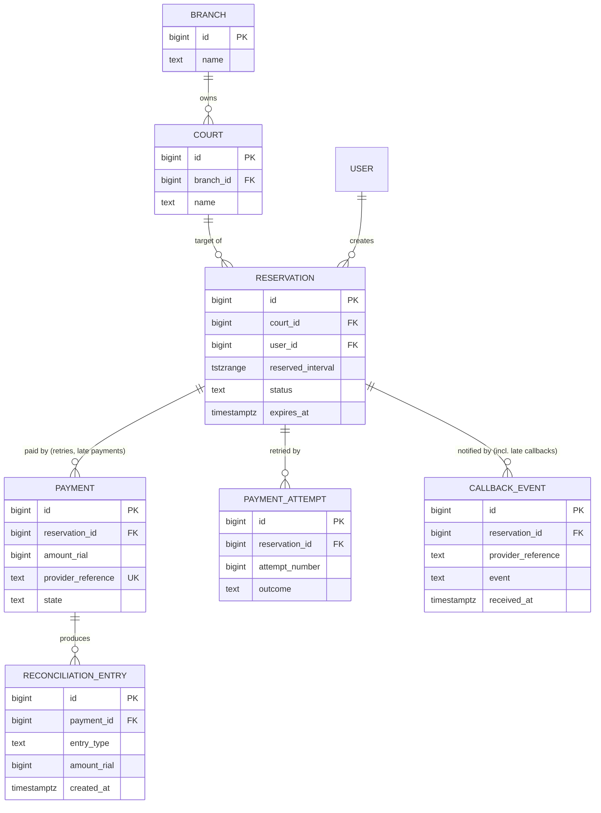
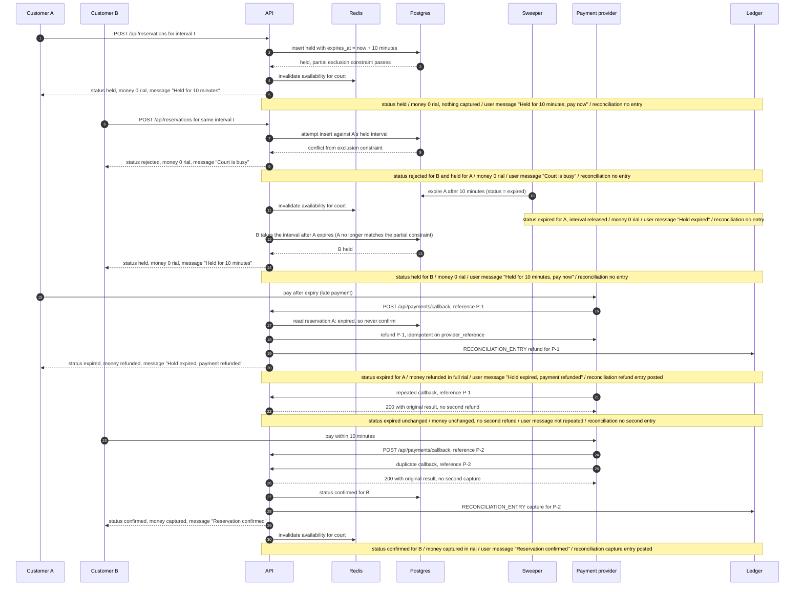

# Task 10 — Multi-branch ERP backend architecture

## Overview

This document designs the backend for 80 branches with court reservation, online payment and
financial reporting; implementation is not required. It specifies the API boundary, ERD, the
late-payment sequence, a capacity model with explicit sizing arithmetic, four SLOs, indicators,
recovery, and a load-test plan. Every number below is either a design input from the specification
or a proposed target — none is a measurement, because this task produces documentation only.

## Assumptions

- 80 branches, each owning several courts; the active intervals of one court must not overlap.
- Peak load is 300 reservation requests/s and 3000 capacity-view requests/s, aggregated across all
  branches; one hot court takes about half of the reservation traffic (about 150 requests/s).
- A temporary reservation is `held` for 10 minutes; a sweeper expires holds past their deadline.
- Money is integer rial (never a float); all timestamps are timezone-aware UTC.
- Payment providers may call back late, repeatedly or out of order; clients may retry.
- A branch manager sees only their own branch data; the central finance manager sees the
  aggregate report, which may be up to 5 minutes stale.
- Latency figures are design inputs (view p95 250 ms is a spec target), not measured results.
- The checker and the 53 tests validate the document's technical claims, not a running system.

## API boundary

| Endpoint | Auth / scope | Contract |
| --- | --- | --- |
| `POST /api/reservations` | JWT carrying `branch_id` | Body: `court_id`, `interval_start`, `interval_end`. Creates a `held` reservation expiring in 10 minutes; the partial exclusion constraint is the final overlap guard. Returns `held` or a conflict for overlap/an existing hold. |
| `POST /api/payments/callback` | Provider signature | Body: unique text `provider_reference`, `reservation_id`, `amount_rial`, `event`. Idempotent: a repeated callback returns the original result with no second capture or refund. |
| `GET /api/courts/{court_id}/availability` | Any authenticated user | Redis availability cache with a short TTL and invalidate-on-change; the 3000 rps capacity hot path with a 250 ms p95 target. |
| `GET /api/reports/finance` | `branch_manager` or `central_finance` | Managers are filtered to their own branch; central finance gets the aggregate. Served from materialized aggregates with a bounded staleness budget (below). |

Rejections and refunds are business outcomes (HTTP 200/409), not transport failures, so provider
retries stay idempotent. An availability response is advisory: it may be stale, while the database
constraint remains authoritative.

## ERD



`reserved_interval` is an attribute of RESERVATION (the thing being reserved), not of COURT.
There is no `provider_reference` on RESERVATION: the unique **text** `provider_reference` lives on
PAYMENT, where this unique provider reference makes callbacks idempotent. A reservation has many payments, many
attempts (retries) and many callbacks (including late payments), so all three relationships are
1:N; a 1:0..1 link would make retries and late callbacks impossible to represent.

Overlap guard, enabled with the `btree_gist` extension (needed for the `=` operator in a GiST
index):

```sql
CREATE EXTENSION IF NOT EXISTS btree_gist;

ALTER TABLE reservation ADD CONSTRAINT reservation_no_overlap
    EXCLUDE USING gist (court_id WITH =, reserved_interval WITH &&)
    WHERE status IN ('held','confirmed');
```

The constraint is **partial**: only `held` and `confirmed` rows participate. Without the WHERE clause, expired holds (and refunded/cancelled rows) would keep occupying their intervals forever, so step 4 of the sample ("B takes the interval") would be impossible: the database would reject B until someone deleted A's row. With the partial predicate the sweeper only changes A's `status` to `expired`, the interval becomes free, and B can hold it. `amount_rial` is an integer count of rial.

## Sequence diagram

The diagram shows two customers choosing the same interval, a late payment from Customer A after
expiry and hand-over to Customer B, and repeated callbacks. Each note records reservation status,
money, user message and the reconciliation path at that step.



## Late-payment walkthrough

Customer A and Customer B request the same interval. A wins the hold; A pays only after the
10-minute expiry and after the interval has been handed to B, so this is a late payment.

| Step | Reservation status | Money | User message | Financial reconciliation path |
| --- | --- | --- | --- | --- |
| 1. A holds the interval | A `held`, expires in 10 minutes | 0 rial, no money captured | "Held for 10 minutes, please pay" | No callback yet, no reconciliation entry |
| 2. B requests the same interval | A stays `held`; B is rejected | 0 rial | "Court is busy, try another interval" | No entry |
| 3. Sweeper expires A | A becomes `expired`, interval released (partial constraint no longer applies) | 0 rial | "Your hold expired" | No entry; expiry is not a money event |
| 4. B takes the interval | B becomes `held`; A stays `expired` | 0 rial | "Held for 10 minutes, please pay" | No entry |
| 5. A's late callback arrives, reference P-1 | A stays `expired`; B stays `held` | Full amount refunded in integer rial; no money retained | "Your hold expired; we refunded your payment" | Callback validated, `PAYMENT` marked `refunded`, `RECONCILIATION_ENTRY` of type `refund` posted and linked to P-1 |
| 6. Repeated callback for P-1 | A stays `expired` | No second refund; unchanged | No duplicate message | Idempotent callback returns the original result because text `provider_reference` is unique on PAYMENT; no second entry |
| 7. B pays within 10 minutes | B becomes `confirmed` | Amount captured, no money refunded | "Reservation confirmed" | `RECONCILIATION_ENTRY` of type `capture` posted; appears in the central finance aggregate within the staleness budget |

## Capacity model

| Input | Value | Handling |
| --- | --- | --- |
| Branches | 80 | Reads scoped by `branch_id`; indexes lead with `branch_id`. |
| Reservation writes | 300 requests/s | Single writer per reservation; batched expiry sweeps; write pool sized below. |
| Capacity views | 3000 requests/s | Redis cache with a 2-second TTL (design input) and invalidate-on-change; one cached GET per view. |
| Hot court | about 150 reservation requests/s | PostgreSQL advisory lock keyed by `court_id` (per-court serialization); the partial exclusion constraint stays the correctness guard. |
| Report freshness | target ≤ 5 minutes | Materialized aggregates; bounded budget below, served via a read replica. |

### Sizing arithmetic (design inputs, not measurements)

Inputs: view p95 250 ms, reservation-commit p95 target 250 ms, 3000 view rps, 300 reservation rps,
hot court 150 rps, proposed hot-court critical section 4 ms, proposed DB time per write 10 ms,
proposed async worker capacity 50 in-flight requests, 2× safety factor.

- Little's Law (view path): concurrency = arrival rate × latency, so 3000 × 0.25 = 750 in-flight
  capacity-view requests at p95. That is the number the gateway and connection buffers must hold.
- Little's Law (write path): 300 × 0.25 = 75 in-flight reservations; those are isolated from the
  750 view requests by separate worker pools and connection pools.
- Hot-court budget: 150 requests/s leave 1 / 150 = 6.67 ms of service budget per request. With a
  4 ms critical section, utilization ρ = 150 × 0.004 = 0.6, and the M/M/1 wait estimate is
  0.6 / (1 - 0.6) × 4 = 6 ms, i.e. about 10 ms end-to-end lock wait — under the 100 ms alert and
  the 250 ms SLO. If the critical section grows toward 6.67 ms then ρ → 1 and the queue diverges;
  this is why the advisory-lock section must stay small.
- Writer connections: 300 × 0.01 = 3 connections at p95; with the 2× safety factor choose 6
  writer connections. The hot court holds at most 150 × 0.004 = 0.6 of one connection while
  serialized.
- Workers: 750 / 50 = 15 async view workers (for example 5 instances × 3 workers). The write pool
  needs 75 / 50 = 2 workers, rounded up to 3 per pool for headroom.

A stale Redis view can advertise a slot that the database then rejects; this is acceptable because
no unpartial overlap can be admitted. These are calculations from design inputs, not measured
throughput.

### Report staleness budget

A materialized view refreshed on a lagging replica can exceed 5 minutes: the refresh interval and
replica lag add up, so "refresh every 5 minutes" alone does not bound staleness. Budget (design
inputs): refresh interval 2 min + worst-case replica lag 3 min = 5 min. Arithmetic: 2 min + 3 min = 5 min, so staleness ≤ 5 min.
Every snapshot carries a `refreshed_at` timestamp shown with the report. The alternative is to
refresh the materialized view on the primary and publish a timestamped snapshot; that removes
replica lag from the budget and is the fallback when lag exceeds 3 minutes.

## SLO

Proposed targets (to be confirmed by the load test; no measurements exist yet).

| Objective | Proposed target | Window |
| --- | --- | --- |
| Capacity-view availability | p95 end-to-end latency ≤ 250 ms at 3000 requests/s | 1 minute |
| Reservation commit | p95 from `POST /api/reservations` to committed `held` ≤ 250 ms | 1 minute |
| Callback processing | p95 from provider callback to persisted payment state ≤ 2 s | 5 minutes |
| Financial report staleness | report `refreshed_at` ≤ 5 min behind wall clock | continuous |

## Indicators and alerts

| Indicator | Definition | Proposed alert |
| --- | --- | --- |
| p95 availability latency | p95 of `GET /api/courts/{court_id}/availability` | Above 250 ms for 5 minutes |
| 5xx error rate | Failed requests divided by all requests | Above 1% for 5 minutes |
| Redis cache hit rate | Cache hits divided by capacity-view reads | Below 95% for 5 minutes |
| Callback lag | Age of the oldest unprocessed payment callback | Above 30 seconds |
| Sweep lag | Age of the oldest `held` reservation past its 10-minute expiry | Above 60 seconds |
| Hot-court lock wait | p95 advisory-lock wait for the hot court | Above 100 ms for 5 minutes |
| Staleness | `now - refreshed_at` on reports | Above 5 minutes |
| Reconciliation mismatches | Captured/refunded payments without a matching reconciliation entry | Any nonzero count |

Thresholds are proposals to be validated by the load test, not measured values.

## Recovery plan

- **Repeated or late callbacks:** the unique text `provider_reference` makes callbacks idempotent;
  a replay returns the original result, never double-captures or double-refunds. A late payment
  after expiry is refunded, posted to reconciliation, and explained to the user.
- **Failed callback processing:** retry with exponential backoff via an outbox; after repeated
  failures move the event to a dead-letter queue and replay it manually once the provider recovers.
- **Money mismatch:** compare captured/refunded payments with the provider settlement file, create
  an adjusting `RECONCILIATION_ENTRY`, and keep the original entry for audit; no money movement is
  deleted.
- **Sweeper lag:** backfill expired holds in batches; changing `status` releases the interval
  because the exclusion constraint is partial.
- **Redis loss:** rebuild the availability cache from PostgreSQL; a stale cache only affects what a
  user sees, never what the database accepts.
- **Replica lag above 3 minutes:** refresh on the primary or keep serving the last timestamped
  snapshot with an explicit staleness notice; never promote a lagging replica for reports.

## Load test plan

- **Tool:** k6, driven from the same region as the API gateway.
- **Ramp:** 0 to 300 reservation requests/s and 0 to 3000 capacity-view requests/s over 10 minutes,
  hold for 30 minutes, ramp down over 5 minutes.
- **Hot-court scenario:** 150 reservation requests/s to one court, the other 150 spread over the
  remaining courts, with capacity views distributed across all 80 branches.
- **Mixed scenario:** normal holds, expiries, duplicate provider callbacks and late payments at a
  fixed rate; a deliberately held slot is expired and handed to a second customer.
- **Measurements to record:** p50/p95/p99 capacity-view latency, commit latency, callback lag,
  reservation error rate, hot-court lock waits, Redis hit rate, sweep lag, report staleness and
  reconciliation mismatches.
- **Pass criteria:** p95 capacity viewing ≤ 250 ms during the 30-minute hold, zero overlapping
  active intervals, zero duplicate captures/refunds from repeated callbacks, staleness ≤ 5 min,
  and no hold older than 10 minutes beyond the alert tolerance.
- These criteria are targets for a future run; no load test has been executed in this
  documentation-only task.

## Decisions and limitations

**Decision 1 — Redis availability cache with a 2-second TTL and invalidate-on-change instead of
querying PostgreSQL for every capacity view.** Cost: an extra Redis dependency and invalidation
code. Limitation: a view can be up to 2 seconds stale, so a customer may see a free slot and then
get "busy"; correctness is preserved by the partial exclusion constraint, but that user-experience
cost is accepted to meet the 250 ms p95 target.

**Decision 2 — Financial reports from materialized aggregates on a read replica with a bounded
refresh/lag budget instead of live queries on the primary.** Cost: a replica, refresh jobs and lag
monitoring. Limitation: reports lag by up to 5 minutes and central finance aggregates are
eventually consistent, so they are unsuitable for real-time settlement; primary write traffic is
not slowed by reporting queries.

## Run and test commands

From this folder, with the local virtual environment created with Python 3.12:

```bash
python3 -m venv .venv
.venv/bin/pip install -r requirements.txt
.venv/bin/python check_doc.py
.venv/bin/python -m pytest -q
.venv/bin/ruff format . && .venv/bin/ruff check . && .venv/bin/ruff format --check .
```

To validate a different document, run `.venv/bin/python check_doc.py path/to/other.md`.

## Unfinished parts

No service code, schema migration or load-test harness was built, because implementation is not
required; all throughput, latency and capacity numbers are specification inputs or proposed targets
rather than measurements. Alert thresholds, the 2-second cache TTL, the 4 ms lock section and the
3-minute replica-lag allowance must be tuned with a real load test. No deployment, CI or frontend
work is included.

## Spot-check record

The checker and doc tests were spot-checked by damaging a copy of this document in memory, running
`.venv/bin/python -m pytest -q --tb=no` and `.venv/bin/python check_doc.py`, and restoring the file
byte-for-byte. All five damages were detected; the file was verified identical after restore.

- Mutation 1 — removed ` WHERE status IN ('held','confirmed')` from the SQL: checker exited 1 with
  `FAIL: missing partial EXCLUDE ... WHERE status IN ('held','confirmed')`; pytest failed
  `test_spec_partial_exclusion_constraint_with_btree_gist`.
- Mutation 2 — changed `RESERVATION ||--o{ PAYMENT` to `RESERVATION ||--o| PAYMENT`: checker exited 1
  with `FAIL: ERD: payments must be 1:N, not 1:0..1`; pytest failed
  `test_spec_erd_one_to_many_payment_attempts_callbacks`.
- Mutation 3 — deleted both staleness-budget lines: checker exited 1 with
  `FAIL: missing staleness budget: refresh interval + replica lag ≤ 5 min`; pytest failed
  `test_spec_report_staleness_budget_is_bounded`.
- Mutation 4 — deleted the line containing `3000 × 0.25 = 750`: checker exited 1 with
  `FAIL: missing sizing arithmetic (Little's Law, lock budget, pool and workers)`; pytest failed
  `test_spec_capacity_model_sizing_arithmetic`.
- Mutation 5 — deleted the callback-processing SLO row: checker exited 1 with
  `FAIL: at least four SLOs required (availability, commit, callbacks, staleness)`; pytest failed
  `test_spec_multiple_slo_targets`.
